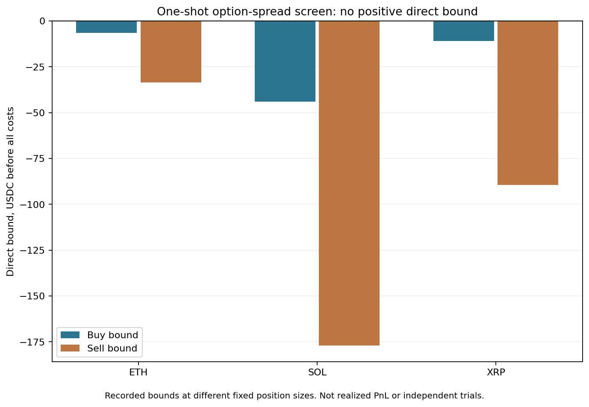

# Option spread bounds

A one-shot screen of three atomic call-spread books found no direct payoff-bound violation. All six tested buy/sell directions had negative margins before fees. This was a quote screen on 26 October 2026, not a historical backtest or a claim that every options strategy loses money.

## Question

A call spread with the same expiry and underlying has a bounded terminal payoff. Buying it below its minimum payoff or selling it above its maximum would be a candidate for a direct pricing violation. An atomic combo book avoids combining separate leg quotes taken at different times. It still does not guarantee execution, adequate collateral or settlement under every exceptional condition.

The study fixed the first alphabetical call spread per underlying from a pre-price metadata census. BTC became inactive before prices were requested and was retained as an exclusion. ETH, SOL and XRP received one public book request each. Earlier metadata and research had already informed selection; this was adaptive development, not independent confirmation.

## Recorded result

| Underlying | Buy-side bound, USDC | Sell-side bound, USDC |
| --- | ---: | ---: |
| ETH | -6.62 | -33.64 |
| SOL | -44.00 | -177.00 |
| XRP | -11.00 | -89.50 |



These are bounds on terminal gross payoff minus initial premium at the registered position sizes. They are not realized trading losses, expected returns or values normalized to equal exposure. The six directions share three books and are not six independent observations. A bootstrap or Monte Carlo over these numbers would not establish statistical significance, persistence or OOS performance.

All six sides had sufficient displayed depth for the specified quantities. Recorded ages were within the study's two-second limit and the batch receipt span was below five seconds. Local receipt checks do not prove synchronized venue clocks or attainable fills. The screen made three requests, with no retry, replacement or later polling.

## Limits

Fees, financing, margin survival, collateral conversion and delivery costs were excluded from this optimistic screen. They were not assumed to be zero in actual trading. Even a positive gross bound would need a complete executable cash model and untouched confirmation. None was positive here. No order, account action, payment or live trading occurred.

The [venue fee reference](https://support.deribit.com/hc/en-us/articles/25944746248989-Fees) was part of the original study's source review. Combo discounts do not establish that every combo is free. This snapshot does not qualify a private account tier or historical fee schedule.

The original preregistration was committed at `f5d4fff` and reviewed collector at `1c508dd` before collection. Those belong to the earlier private research record; creating this public snapshot later is not public preregistration. No confirmation period was opened or unsuccessful contract replaced.

## Reproduce this snapshot

With Python 3 and the listed plotting dependency:

```text
python verify_snapshot.py
python plot_results.py
```

The verifier checks the exact aggregate payload and file manifest, with network access disabled. The plot uses only `aggregate_results.json` and writes a fresh copy to `reproduced_figures/`. Raw books, quote-level premiums, private history and original capture inputs are excluded. This reproduces the aggregate figure and consistency checks, not the original source acquisition or a complete trading backtest. Pixel equality across plotting environments is not claimed.
